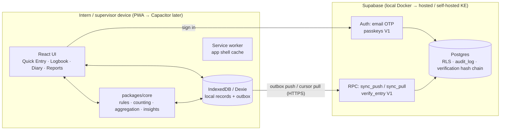

# Architecture & Implementation Proposal

**Project:** Digital Dental Internship Logbook, Clinical Diary & Progressive Reporting Platform
**Date:** 8 October 2026 · **Status:** Approved and implemented as the MVP (M1–M4). See [01-architecture.md](01-architecture.md) for the system as built.
**Inputs:** your build brief; *Digital Dental Logbook Blueprint v1.1*; `logbook_reference_schema_1.sql`; *KMPDC National Guidelines and Logbook for Dental Interns, 3rd ed. (Oct 2024)*, 122 pp.

---

## 1. What exists today

| Item | Finding |
|---|---|
| Repository | `C:\Users\HP\Desktop\Intern Logbook` is **empty** and not a git repo. There is no existing code, UI, auth or deployment, so nothing will be overwritten. |
| Toolchain | Node 26.4 / npm 11.17, Docker 29.6, Python 3.13, git 2.54. No local `psql`. Docker means a local Postgres or Supabase stack can run. |
| Domain source | The KMPDC logbook PDF has extractable text. The blueprint's catalogue matches it (spot-checked: levels, PAED 4/5, CONS 01/02, endodontics). |
| Prior design | The blueprint and reference schema are thorough and already tested against Postgres 16. **This proposal builds on them and does not start over.** |

The brief describes a general-purpose platform, and the blueprint describes a KMPDC-specific logbook. I treat the **KMPDC 3rd-edition requirement set as the first configured framework**. The engine itself stays framework-agnostic, as the brief requires (§6, §34).

---

## 2. Reconciling the brief with the blueprint and KMPDC

These are the places where the brief, the blueprint and the KMPDC book disagree, and how I propose to resolve each one. Each resolution changes the design.

| # | Conflict | Resolution |
|---|---|---|
| C1 | **Competency scale.** The brief uses 0–5 (observed, assisted, supervised, independent, "consistent competence"). KMPDC uses 1–5: L1 observe, L2 assist, **L3 direct supervision, L4 indirect supervision**, L5 independent. | Use the **KMPDC scale**. "Level 0 / no exposure" is a *derived display state*, not a recorded value. The system never derives "consistent competence". Only supervisor assessments (grades 0–3, V1) speak to competence. |
| C2 | The brief has separate "Activity" (performed/assisted/observed) and "Role" fields. | Merge them into **one level field**. Two fields that say the same thing invite contradictions. |
| C3 | The brief lists 12 "rotations" (OPD, Endo, Radiology, Theatre…). KMPDC has **5 rotations** (OMF, PAED+Ortho, PER, CONS+Prostho, Community). | **Rotation** = the KMPDC rotation, defined by the requirement set and assigned automatically from the date. **Clinic/setting** (OPD, theatre, ward, emergency, outreach) becomes a light optional tag. |
| C4 | The brief's progress counts all levels toward a target. KMPDC counts **signed** entries, and the counting rules are undefined. | Show three numbers per code: **logged**, **verified**, **at expected level**. Use counting rules R1–R10 from the blueprint, labelled "met (default rules)" until an ITC confirms them. |
| C5 | Two meanings of "diary". The brief means a *reflective learning diary*. The blueprint's `diary_event` is a *patient case timeline*. | Keep both and name them apart. **Reflection Diary** (new `reflection` table, intern-private) and **Case Timeline** (derived from encounters per pseudonymous patient ref). |
| C6 | Supervisor verification is V1 in the brief but MVP in the blueprint. | Build the **data model and entry statuses in MVP** (verification is a separate, append-only, hash-chained table) and the **supervisor queue UI in V1**. Paper pages still carry wet signatures, so no evidence is lost. |
| C7 | Patient journey: the brief calls it a "future module, only if safe", and the blueprint puts a "thin case thread in MVP". | MVP stores only what the paper book already holds: **patient no. plus birth year and sex** (birth year is needed for the PAED under-17 rule). The case timeline is a *view* over existing entries, with no extra data. Treatment plans and next-visit briefs move to V1. Names, phones, IDs and photos are never collected in personal mode. |
| C8 | The brief's "Clinical hours" dashboard card | KMPDC does not require hours, and recording them adds burden. **Dropped from MVP.** It can return later as optional session logging. |
| C9 | The brief's weekly/monthly reports vs KMPDC monthly assessment forms and community weekly reports | They serve different purposes. **Personal reports** (brief) are computed analytics. **KMPDC forms** (V1) are signed documents that embed a progress snapshot. Both read from the same data. |
| C10 | Gaps in KMPDC (G1–G12: uncoded ortho/prosthodontics, CONS 07 has no rows, the CONS 02 misprint…) | Adopted as the blueprint handles them. Uncoded competencies are tracked and visible but not counted. |

**Principle kept from both documents:** targets must never drive treatment. Gap alerts appear only in logbook and analytics views, never at the point of clinical choice. Insight wording speaks of *recorded exposure*, never competence.

---

## 3. Architecture decision

### 3.1 Recommended stack

```
apps/web          React 18 + TypeScript + Vite + Tailwind, PWA (vite-plugin-pwa)
packages/core     Pure TypeScript domain engine: catalogue, mapping & counting rules,
                  aggregations, insights, validation. No framework or IO dependencies.
supabase/         Postgres migrations, RLS policies, RPC functions, seed, SQL tests
```

| Layer | Choice | Why, and what I rejected |
|---|---|---|
| Client | **React + Vite SPA, installable PWA** | The app sits behind a login and must work offline. Server rendering (Next.js) adds a server dependency to every page and makes offline use and app-store packaging harder. A static bundle runs as a PWA now and can be wrapped with **Capacitor** for Android/iOS later from the same code. |
| On-device store | **IndexedDB via Dexie**. The UI reads and writes locally first. | The UI never waits on the network. SQLite-WASM was rejected for now (heavier, OPFS quirks on iOS Safari); it can be revisited with Capacitor + SQLCipher. |
| Domain logic | **`packages/core`, shared and pure** | The same rules and report maths run on the device (reports work offline) and on the server (verification, institutional analytics). This is the most heavily tested part of the system. |
| Backend | **Supabase**: Postgres 15+, Auth (email one-time code), row-level security, RPC/Edge Functions. Runs locally in Docker for development. | It matches the blueprint's schema and RLS design. It is open source and **self-hostable in a Kenyan data centre** (DHA s. 47), so there is no lock-in. A custom Node API was rejected for MVP because it means rebuilding auth and RLS. |
| Sync | **Hand-written outbox** plus `sync_push` / `sync_pull(since)` RPCs. Records use client-generated UUIDv7. | MVP records are mostly append-only, so conflicts are rare. Sync engines (PowerSync, ElectricSQL) will be re-evaluated at V2. |
| Reports & export | React report pages with **print CSS → browser "Save as PDF"**, plus client-side **CSV**. | This works offline and needs no PDF server. Pixel-faithful KMPDC pages need server HTML→PDF, which comes in V1. An XLSX export can follow, and CSV opens in Excel. |
| Charts | Recharts | Covers the needed chart types at a modest size. |
| Tests | **Vitest** for core and components, **Playwright** for end-to-end runs (including offline mode and mobile viewport), SQL tests for RLS. | Covers the brief's §30 list. |

### 3.2 Architecture diagram



### 3.3 The compounding data model

Reports are **never stored as source data**. Every number is a function of the underlying entries:

```
report(period P) = aggregate(entries where date ∈ P)            ← "during the period"
                 + aggregate(entries where date ≤ end(P))       ← "cumulative since start"
                 + diff vs previous period of same length         ← "compared with last month"
```

Daily → week → month → rotation → midpoint → internship are all the same function over different date ranges. When a report is *finalised* (submitted to a supervisor or exported), an immutable **snapshot** (JSON payload plus content hash) is saved. A later edit to an entry then shows as a discrepancy against the snapshot instead of silently changing a signed document.

Periods default to **internship-relative** ("Week 7", "Month 3", counted from the internship start date), as in the brief. Calendar weeks and months are available as an option.

---

## 4. Data model (MVP)

The model starts from `logbook_reference_schema_1.sql`. Changes:

**Kept as designed:** `facility`, `requirement_set`, `requirement`, `procedure_type`, `code_mapping`, `internship`, `rotation`, `patient` (pseudonymous), `encounter`, `encounter_procedure`, `finding`, `investigation`, `activity`, `logbook_entry`, `verification` (append-only, hash chain), `audit_log` (UPDATE/DELETE revoked), the `requirement_progress` view, and the `provenance` columns.

**Changed:**
- `user_account` → `profile`, keyed to `auth.users.id`. `id_doc_no_enc` is **deferred**: it is needed only for printed KMPDC forms (V1), and storing a national ID in MVP has no purpose.
- `patient`: **no** `*_enc` identity columns are created in personal mode. They are added only by an institutional-mode migration.
- `encounter` gains `setting` (OPD / ward / theatre / emergency / outreach), `referred_to` (text) and `follow_up_needed` (bool). These cover referrals and follow-ups without the V1 tables.
- Every synced table gets `client_created_at`, `updated_at`, `deleted_at` (soft delete, allowed only while status = draft) and `rev`.

**Added:**
| Table | Purpose |
|---|---|
| `reflection` | Reflection Diary: optional link to an encounter or activity; prompts (*what was interesting / learned / challenging / do differently / revise / need more exposure*); tags ⭐ important, 📚 learning, ⚠️ challenging, 🧠 revision, 🏆 milestone. Intern-private by default. |
| `report_snapshot` | Finalised report: type, period, payload JSON, `sha256`, finalised_at. |
| `uncoded_competency` + `uncoded_log` | Orthodontic, prosthodontic and general expectations (KMPDC 4.2, 4.4.2, 4.6.2): tracked, not counted. |
| `user_preference` | Favourite procedures, dashboard widgets, default supervisor. |
| `notification` | Reminders (end of day, rotation ending, report ready). |
| `supervisor` (lightweight) | MVP supervisor *names* with role and KMPDC reg. no., which the intern can pick. Becomes a linked user account in V1. |

**Deferred to V1+:** `treatment_plan`, `plan_item`, `appointment`, `assessment`, `case_report`, `referral` (full), `prescription`, `media_asset`, `consent`, `ai_suggestion`, patient-facing `diary_event`.

**Logbook entries are derived.** When an intern saves an encounter, `core` applies `code_mapping` and the counting rules to create `logbook_entry` rows. The intern sees each code and the rule that produced it on the review strip before saving. The intern never selects a KMPDC code by hand for a routine procedure, but can override with a reason, which is logged.

---

## 5. Quick Clinical Entry (the adoption test)

Target: **median ≤ 45 s, ≤ 8 taps** for a returning patient with one procedure.

```
┌ New entry ─────────────── Today 10:42 · CONS rotation (auto) ┐
│ Patient no.  [OP-26-04417 ▾]  recent: 04417 · 03981 · new… │
│ Procedure    [Composite] [Amalgam] [RCT stage] [Extraction] │  ← favourites, ordered by
│              [Scaling]   [Exam+plan] [More…]                │    current rotation + recency
│ Tooth        FDI chart (shown only if procedure is per-tooth)│
│ Level        [1 Obs] [2 Assist] [3 Direct] [4 Indirect] [5 Indep] │  ← never pre-filled
│ Supervisor   [Dr B. Njoroge ▾]  (last used)                 │
│ ── Will log: CONS 01 · posterior tooth 36 · rule R3 ──      │
│ [+ details]  diagnosis · investigation · referral · reflect │
│                 [ Save ]   [ Save & repeat ]                │
└──────────────────────────────────────────────────────────────┘
```

Safe defaults: date = now, rotation = from date, supervisor = last used. **Clinical facts and level are never pre-filled.** Activities (talks, postmortems, calls, conference presentations, community steps) use a parallel two-field "Log activity" sheet.

Data-quality checks are warnings, not blocks: duplicate (same patient, procedure, tooth and day), date outside any rotation, procedure unusual for the rotation, PAED code with patient ≥ 17 or no birth year, entry logged more than 3 days late (R8), and free text that looks like a name or phone number (privacy guard).

---

## 6. Permission model

| Action | Intern | Supervisor (V1) | Coordinator (V1) | Admin |
|---|---|---|---|---|
| Create/edit own draft entries, diary | own | – | – | – |
| Edit after verification | correction record only | – | – | – |
| Verify / adjust level / return | – | entries submitted to them | – | – |
| View progress | own | assigned interns | cohort counts, masked patient refs | – |
| View reflection diary | own | only entries the intern shares | – | – |
| Configure requirement sets, procedures, rules | – | – | facility-level overrides | ● |
| Export | own | – | cohort counts | – |

Enforced with Postgres **RLS** on the server and mirrored in client route guards. The server is authoritative.

---

## 7. Offline and sync

- Every write goes to IndexedDB first and is queued in an outbox. The UI shows 🟢 synced, 🟡 pending (with count) and 🔴 error (with retry and reason).
- New records never conflict because they use client UUIDv7 IDs. Draft edits resolve last-writer-wins per record with a notice. Verified entries are rejected by the server and the intern is offered a correction record.
- The server stores both device time and receive time, and flags large clock skew.
- The service worker caches the app shell, so the app opens with no signal.
- Honest limit: in a browser, IndexedDB is protected by the device's own encryption, not an app key. Mitigations are no direct identifiers, auto-lock and remote sign-out. App-level encryption (SQLCipher plus keystore) arrives with Capacitor in V2.

---

## 8. Security and privacy (MVP controls)

Email one-time-code login with no passwords; session lock after inactivity · RLS on every table · TLS · no patient identifiers in URLs (routes use opaque UUIDs) · no clinical content in logs or analytics · append-only `audit_log` · hash-chained `verification` · full personal export (CSV + PDF) and account deletion · **synthetic data only** in development and demo. The blueprint's Kenyan legal checklist (DPA 2019, DHA 2023, ODPC registration, DPIA) applies before any real pilot. It is a pilot gate, not a build blocker.

---

## 9. Smart insights (rule-based, no AI in MVP)

Each insight is a template filled from computed numbers, and it carries its **evidence** (query plus counts), shown on tap:

- "You recorded **18 extractions** in Month 3, compared with **9** in Month 2."
- "Recorded endodontic exposure (CONS 03) is **4 of 20**, with 3 weeks of the rotation left. At the current pace you'd reach ~7."
- "Most of your PER 05 entries are at Level 1. The expected level is 2."
- "Exposure appears limited based on recorded activities." This is the wording used for every gap.

AI drafting (V3) will run only through a server gateway that strips identifiers, stores outputs as *pending suggestions*, and cites the source entry IDs for every sentence.

---

## 10. Phasing: what gets built now vs later

### Now: MVP, in four milestones

| Milestone | Delivers | Proof |
|---|---|---|
| **M1 Core engine + synthetic data** | Monorepo; `packages/core` with the KMPDC 3rd-ed catalogue (42 codes plus community), procedure→code mapping, counting rules R1–R10, period/cumulative aggregation, insights, validation. Synthetic generator: **"Dr Alex Mwangi"**, 12 months, 5 rotations, ~1,500–2,000 encounters with realistic ramp-up. | Vitest suite: mapping, counting, rotation-by-date, reports, edge cases |
| **M2 Local-first web app** | PWA shell; onboarding (profile, internship, rotation calendar); Quick Entry + activities; Logbook (search/filter by date, patient ref, procedure, code, rotation, level, status, tag); Reflection Diary; Competency tracker; Dashboard (cards, activity chart, gaps, insights, progress timeline); Weekly / Monthly / Rotation / Cumulative / Portfolio reports; CSV + print-to-PDF. Fully usable offline with seeded demo data. | Component tests; manual mobile check |
| **M3 Backend + auth + sync** | Supabase local stack; migrations from the reference schema with the changes in §4; RLS; email OTP auth; outbox sync; audit log; sync status UI. | SQL/RLS tests; sync integration tests |
| **M4 Hardening + docs** | Playwright E2E (entry, edit, delete-draft, duplicate warning, offline→online sync, reports, export, permissions, mobile viewport); README, architecture, schema, API, deployment, user guide, security docs. | Green test run; docs in `/docs` |

### Later

| Version | Scope |
|---|---|
| **V1** | Supervisor accounts and verification queue (batch verify, adjust level, return; PIN/passkey); KMPDC assessment forms auto-filled; print-faithful KMPDC log pages (server PDF); case reports; treatment plans and next-visit brief; handover list; web-push reminders. |
| **V2** | Capacitor Android/iOS; encrypted SQLite; sync-engine evaluation; coordinator cohort view. |
| **V3** | AI gateway: diary summarisation, report drafting, final-reflection draft. Pending suggestions only, every sentence traceable. |
| **V4** | Institutional mode (facility as data controller), dashboards, de-identified analytics. |
| **V5** | Additional requirement sets (medical, nursing, clinical officer, BDS), multi-profession. |

---

## 11. Assumptions (I will proceed on these unless you say otherwise)

1. KMPDC 3rd edition is the first framework, with blueprint defaults R1–R10 for counting.
2. Personal mode only. The intern owns the record, and no patient identifiers beyond hospital no., birth year and sex are stored.
3. English UI. A Kiswahili option is deferred.
4. Internship-relative weeks and months by default.
5. The demo intern is **Dr Alex Mwangi** at a fictional "Example County Referral Hospital". All data is synthetic.
6. Supervisors exist in MVP as *selectable names*. Supervisors become sign-in users in V1.
7. I will `git init` the folder and commit at each milestone, on a branch rather than directly on `main`.

## 12. Decisions I need from you

1. **Backend.** Use **Supabase, running locally in Docker for development** (recommended), with hosting decided later (Supabase cloud or self-hosted in Kenya)? Or should M1–M2 stay device-only and the backend be postponed?
2. **Go-ahead** to scaffold the monorepo and start **M1** (core engine plus synthetic data). M1 is pure TypeScript and fully reversible.

Everything else has a documented default above and can be changed later through configuration rather than rework.
