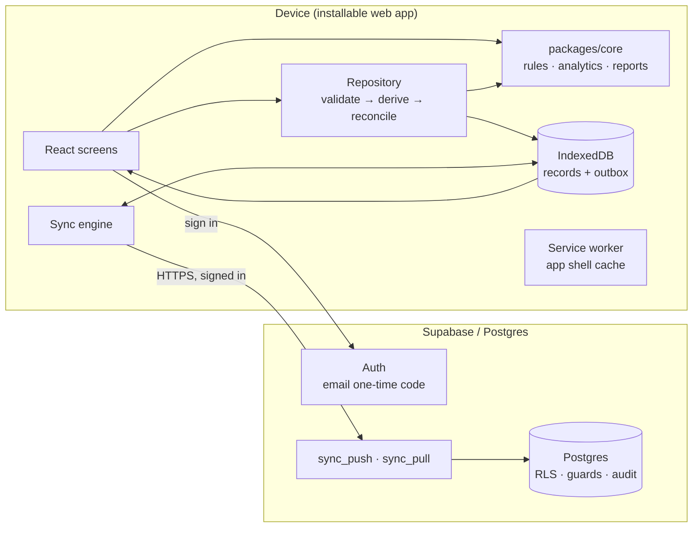

# Architecture

This describes the system as built in the MVP (M1–M4). The reasoning behind the choices is in [00-architecture-proposal.md](00-architecture-proposal.md).

## Overview



**Local-first.** Every read and write goes to IndexedDB on the device. Screens never wait for the network. The server is a backup and a multi-device channel, not a dependency.

**One domain engine.** `packages/core` is pure TypeScript with no framework or I/O. It holds all clinical-logbook logic, so the rules are the same wherever they run and can be tested exhaustively.

## Packages

| Package | Responsibility |
|---|---|
| `@logbook/core` | Types; KMPDC 3rd-edition requirement set (versioned data); procedure and activity catalogue with mapping rules; counting rules R1–R10; derivation and reconciliation of logbook entries; verification hash chain; validation; periods, statistics, progress, insights, timeline, reports, portfolio; CSV export; sync wire format; synthetic demo generator |
| `@logbook/web` | React 19 + Vite PWA; Dexie store; repository; screens; sync engine and Supabase transport |
| `@logbook/db` | Runs `supabase/migrations` in PGlite with a Supabase auth shim, and tests them |
| `supabase/` | Migrations and CLI config |

## Core data flow: enter once

```
Intern records a visit (what happened)
   │
   ▼
validateEncounter()      errors block saving; warnings are shown
   │                     (duplicate, late entry, unusual for rotation, primary tooth
   │                      in an adult, text that looks like a name/phone/ID …)
   ▼
deriveEncounter()        procedure + tooth + rotation + age + alerts → KMPDC codes,
   │                     each with the rule that produced it, plus a reason for
   │                     anything that does not count
   ▼
reconcileEntries()       match against stored entries: create / update / withdraw;
   │                     verified entries are never changed (conflict → refused)
   ▼
IndexedDB transaction    visit + entries + outbox items, all or nothing
   │
   ▼
Live query → indexed dataset → every screen recomputes from the same data
```

Logbook entries are **derived, never typed**. The intern sees the code and the rule on the review strip before saving. Entries start as `submitted` and only a supervisor verification (V1) can make them `verified`. The database enforces this too.

### Mapping and counting rules

Each procedure type has an ordered list of mappings. The **first** mapping whose condition matches wins, so one procedure never counts twice (R6). Conditions:

| Condition | Example |
|---|---|
| rotation (R1, configurable) | Extraction → OMF 2 only during OMF |
| patient under 17 (R7) | Extraction → PAED 2 during PAED |
| tooth class from FDI | Composite on 11 → CONS 02; on 36 → CONS 01 |
| systemic condition alert | Scaling → PER 02, otherwise PER 03 |
| diagnosis recorded (R5) | Exam + plan → OMF 1 |
| final stage only (R4) | RCT counts at obturation; crown at cementation |

Per-visit codes count once per encounter. Tooth procedures count once per tooth (R3). Procedures with no KMPDC code (dentures, orthodontic appliances, venepuncture…) are tracked as exposure against the "uncoded" competencies (G1, G2, G6).

The rules are **data**. A new KMPDC edition is a new `RequirementSet`, and a training centre's ruling changes `CountingRules` in Settings. Reports state whether the rules are defaults or confirmed.

## Analytics: reports compound automatically

Nothing in a report is stored as source data. Each report is a function of the entries:

```
report(P) = stats(entries in P)            "during the period"
          + stats(entries up to end of P)  "cumulative since the start"
          + stats(previous period)         "compared with last week / month"
```

Weeks and months count from the internship start ("Week 7", "Month 3"); calendar periods are also available. The test suite asserts that weekly, monthly and rotation totals each add up to the cumulative total.

**Finalising** a report freezes a snapshot with a SHA-256 of its payload. If the underlying records change later, the report view says so instead of silently differing from what was shared.

**Insights** are rule-based, and each carries its evidence (the numbers it rests on) and a basis label (*recorded data* or *interpretation*). The wording speaks of recorded exposure, never competence, and never suggests a treatment for a patient. The level-gap insight looks at the **most recent** verified entries, because early-rotation entries are naturally below the expected level.

## Phone-first storage

The phone is the system of record for the intern; the server is optional.

| Concern | Design |
|---|---|
| First launch | `initDeviceStorage()` opens the IndexedDB database, records the setup date and calls `navigator.storage.persist()`. In the native app, storage is app-private and never evicted. Onboarding confirms "Storage is ready on this phone". |
| Native shell | Capacitor 8 in its own workspace (`apps/mobile`, native project in `apps/mobile/android`) packages the `apps/web` build. The service worker registers only on the web. |
| Backups | Native: automatic daily JSON backup to `Documents/DentalLogbook`, only when data changed, last 7 kept, falling back to app storage, restorable from Settings. Web: share sheet or download, with a 7-day reminder. Demo data is never backed up. |
| Privacy | Android system cloud backup and device transfer are disabled, so data leaves the phone only through the intern's own backups or sync. |

## Supervisor sign-off on the phone

`verificationQueue()` and `reviewChecks()` (core) feed the review screen. `signOff()` (repository) checks the supervisor's PIN (PBKDF2 hash in `supervisor.pinHash`, device-only and stripped from the wire format), then creates one hash-chained verification per decision with method `pin` and updates entry status, all in a single transaction. Verifications push after entries. On the server (migration 0400), a trigger sets entry status from each verification, device-set statuses are ignored, and edits to verified entries are refused.

## Offline and sync

| Concern | Design |
|---|---|
| App shell offline | Workbox precaches all built assets; navigation falls back to `index.html`. E2E-tested with the server stopped. |
| Data offline | IndexedDB is the primary store. Every write appends to `outbox`. |
| IDs | UUIDv7 generated on the device, so records created offline never collide. |
| Push | The outbox is drained in parent-before-child order (`PUSH_ORDER`), in batches of 200. The latest state of each record is sent. Accepted items leave the outbox. Rejected items stay with the server's reason and are retried up to 5 times. Items queued during a push are kept for the next round. |
| Pull | Everything with `server_seq` > cursor, including soft-deleted rows. Records with unsent local changes are skipped, so the device's newer edit wins until pushed. |
| Conflicts | New records never conflict. Edits are last-writer-wins per record. Verified entries are rejected by the server with an explanation. |
| Triggers | On sign-in, on reconnect, 1.5 s after local changes, and every 60 s. |
| Status | Synced, pending (count), syncing, offline or error — always an icon plus words. |
| Demo data | Never syncs. |

**Known limitation.** `server_seq` comes from a sequence, so a transaction that commits after a later one could, in principle, be skipped by a concurrent pull. With one intern per account and few devices this is unlikely. The planned mitigation is a periodic full re-pull (`resetCursor()`), already used after sign-in.

## Front end

- **Routing:** React Router 7. Today and Quick Entry load with the shell; the other screens are code-split. The demo generator and charts load on demand. The initial download is about 140 KB gzipped.
- **State:** one live query loads the internship into memory (a full year is about 1,500 entries). `indexDataset()` precomputes lookups, and each screen derives what it needs with `useMemo`. In the production build, a 12-month internship opens to an interactive dashboard in about 0.3 s.
- **Design system:** CSS custom properties in light and dark themes, plus Tailwind 4. Familjen Grotesk is used for display text, Public Sans for body and IBM Plex Mono for codes and tooth numbers, all self-hosted so they work offline. The signature element is the five-step level ladder (L1→L5), used both as the entry control and as the read-out. Rotation colours follow a fixed categorical order, status colours are reserved and always paired with an icon and a label, and every chart has a table view.
- **Accessibility:** visible focus rings, labelled radio groups for levels and teeth, at least 44 px touch targets (40 px for tooth keys, tested at phone size), reduced-motion respected, and no horizontal scrolling at 375 px (tested on 11 pages).

## Roadmap

| Version | Scope |
|---|---|
| **V1** | Supervisor accounts and verification queue (`verify_entry()` with passkey/PIN, batch verify, adjust level, return with comment, chairside QR). Narrower RLS policies for supervisors and coordinators. KMPDC-layout print pages from verified entries (server HTML→PDF). Assessment forms with auto-filled identity and progress snapshot. Case reports. Treatment plans, next-visit brief and handover list. Web push reminders. |
| **V2** | Capacitor Android/iOS app with an encrypted SQLite store and keystore-held keys; re-evaluate managed sync engines; coordinator cohort view. |
| **V3** | AI gateway: identifier stripping, suggestions stored as *pending*, every generated sentence citing source entry IDs (the template-based reflection draft already follows this rule). |
| **V4** | Institutional mode (the facility as data controller), identity fields under encryption, de-identified analytics. |
| **V5** | Further requirement sets: medical, nursing, clinical officer, BDS. |
